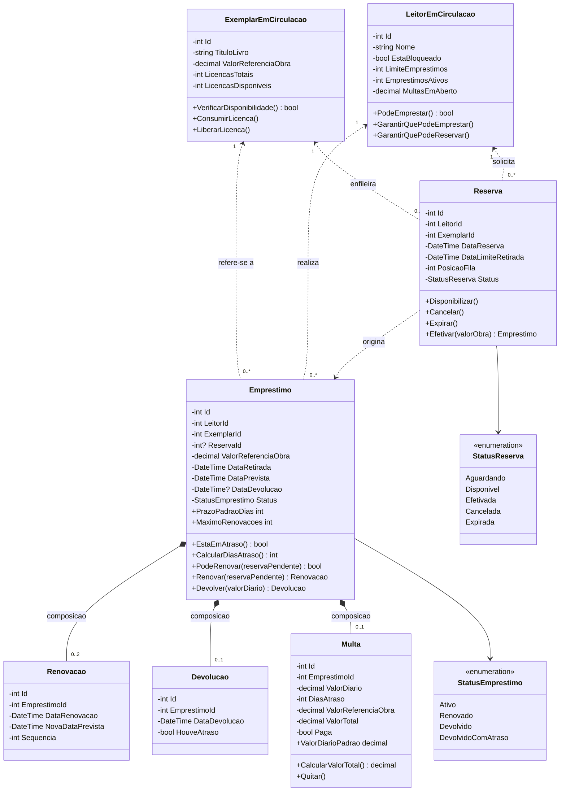

# Sistema de Gestão de Biblioteca Digital

Portal web em **ASP.NET Core MVC (.NET 10)** com persistência relacional via **Dapper + SQLite** para administrar um acervo de obras digitais e seus leitores.

Projeto da disciplina de Programação Orientada a Objetos (ILP007) — Prof. Me. Douglas Samuel Gonçalves
FATEC Ribeirão Preto — Análise e Desenvolvimento de Sistemas

---

## Equipe e divisão dos módulos

| Módulo | Responsável | RA | Situação |
| --- | --- | --- | --- |
| 1 — Gestão de usuários | Felipe dos Santos Lofrano | 2840482511043 | Pendente |
| 2 — Catálogo e acervo digital | Gabriel Enzo dos Santos Teodoro Souza | 2840482421015 | Pendente |
| **3 — Empréstimos e devoluções** | **Otávio Ricardo Barbosa dos Santos** | **2840482511039** | **Implementado** |
| 4 — Leitura e interação digital | Claudio Mauricio Bispo Junior | 2840482421007 | Pendente |

> Quem for implementar os módulos 1, 2 e 4 deve ler o **[GUIA.md](GUIA.md)** antes de começar: ele descreve o padrão arquitetural a seguir, onde cada arquivo entra e o que precisa ser ajustado na fronteira com o módulo 3.

---

## Módulo 3 — Empréstimos e devoluções

Este módulo controla a circulação do acervo, onde estão as regras mais sensíveis do sistema.

| Entrega | Onde está |
| --- | --- |
| Classe `Emprestimo` | `Models/Emprestimo.cs` |
| Classe `Reserva` | `Models/Reserva.cs` |
| Classe `Devolucao` | `Models/Devolucao.cs` |
| Classe `Renovacao` | `Models/Renovacao.cs` |
| Classe `Multa` | `Models/Multa.cs` |
| Regras de prazo e renovação | `Emprestimo.PodeRenovar` / `Emprestimo.Renovar` |
| Controle de disponibilidade | `ExemplarEmCirculacao.ConsumirLicenca` / `LiberarLicenca` |
| Cálculo de multas | `Multa.CalcularValorTotal` / `Emprestimo.CalcularDiasAtraso` |
| Exceções personalizadas | `Exceptions/` |
| Diagrama de classes | [seção abaixo](#diagrama-de-classes-do-módulo-3) |
| Telas | `Views/Emprestimos/`, `Views/Reservas/`, `Views/Home/` |

### Regras de negócio implementadas

| Regra | Implementação |
| --- | --- |
| Prazo padrão de 14 dias | `Emprestimo.PrazoPadraoDias`, aplicado no construtor |
| No máximo 2 renovações | `Emprestimo.MaximoRenovacoes` → `LimiteRenovacoesException` |
| Não renova em atraso | `Emprestimo.Renovar` verifica `EstaEmAtraso()` |
| Não renova com reserva pendente | `IReservaRepository.ExisteReservaPendenteParaOutroLeitor` |
| Multa por dia de atraso | `Multa.ValorDiarioPadrao` × `DiasAtraso` |
| Multa limitada ao valor da obra | `Multa.CalcularValorTotal` + `CHECK (ValorTotal <= ValorReferenciaObra)` |
| Leitor bloqueado não empresta | `LeitorBloqueadoException` |
| Leitor com multa aberta não empresta | `MultaEmAbertoException` |
| Leitor não passa do próprio limite | `LimiteEmprestimosException` |
| Empréstimo só com licença livre | `ExemplarIndisponivelException` |
| Reserva expira se não retirada | `ReservaExpiradaException` |
| Devolução libera a licença e avança a fila | `EmprestimosController.Devolver` → `LiberarProximaReserva` |

### Diagrama de classes do módulo 3



`LeitorEmCirculacao` e `ExemplarEmCirculacao` são a visão que o módulo 3 tem do leitor e do exemplar: só os dados e comportamentos de que a circulação precisa. Quando os módulos 1 e 2 entregarem `Leitor` e `ExemplarDigital`, essas duas classes passam a ser alimentadas por eles — a troca está isolada em `ICirculacaoRepository` e descrita no [GUIA.md](GUIA.md).

### Onde cada conceito de POO aparece

| Conceito | Onde está |
| --- | --- |
| **Encapsulamento** | Todos os campos são privados; propriedades com `private set`. `Emprestimo.DataPrevista` só muda por `Renovar()` ou `Devolver()`; `Multa.Paga` só por `Quitar()`. |
| **Construtores válidos** | `Emprestimo`, `Reserva`, `Renovacao` e `Multa` lançam `DominioException` com dados inconsistentes. Não existe multa com zero dias de atraso nem renovação com sequência 0. |
| **Composição** | `Emprestimo` possui `List<Renovacao>`, `Devolucao` e `Multa`. O ciclo de vida é do empréstimo — no banco, `ON DELETE CASCADE`. |
| **Interfaces** | `IRepository<T>`, `IEmprestimoRepository`, `IReservaRepository`, `ICirculacaoRepository`, `IFabricaConexao`. |
| **Generics** | `IRepository<T> where T : class`, implementada por `EmprestimoRepository` e `ReservaRepository`; coleções `List<T>`, `IEnumerable<T>`, `IReadOnlyList<T>`. |
| **Exceções customizadas** | `DominioException` como base, com seis exceções de circulação herdando dela. |
| **Tratamento centralizado** | `RepositorioDapperBase.Executar` captura falhas do banco e re-lança como `DominioException`; `ControladorBase.ExecutarRegra` converte em alerta amigável. O usuário nunca vê a tela 500 por falha de regra. |
| **Dapper parametrizado** | Todo SQL em `Repositories/Dapper/` usa parâmetros nomeados. Zero concatenação de string com dado de usuário. |
| **MVC e DI** | Controllers recebem só interfaces, registradas com `AddScoped` em `Program.cs`. Nenhuma linha de SQL em Controller ou View. |

> **Herança e polimorfismo** são entregues pelo **módulo 1** (`Usuario` abstrata → `Leitor` / `Administrador`), conforme a divisão da equipe.

---

## Como executar

### Pré-requisitos

- [.NET SDK 10.0](https://dotnet.microsoft.com/download/dotnet/10.0) ou superior
- Nenhum servidor de banco: o SQLite é um arquivo local criado automaticamente

### Passo a passo

```bash
git clone <url-do-repositorio>
cd gestao-biblioteca-poo

dotnet restore
dotnet run --project BibliotecaDigital.Web
```

Acesse **http://localhost:5080**.

### Connection string

Em `BibliotecaDigital.Web/appsettings.json`:

```json
{
  "ConnectionStrings": {
    "BibliotecaDigital": "Data Source=biblioteca.db;Foreign Keys=True"
  },
  "Banco": {
    "ExecutarScriptNaInicializacao": true,
    "CaminhoScript": "Database/script.sql"
  }
}
```

O arquivo `biblioteca.db` é criado na pasta do projeto na primeira execução.

### Script SQL

`BibliotecaDigital.Web/Database/script.sql` traz o DDL e a carga de teste. Na inicialização, `InicializadorBanco` verifica se a tabela `Usuario` existe; se não existir, executa o script inteiro. Para recriar a base do zero, apague `biblioteca.db` e rode `dotnet run` de novo.

Execução manual:

```bash
sqlite3 biblioteca.db < BibliotecaDigital.Web/Database/script.sql
```

---

## Arquitetura

```
BibliotecaDigital.Web/
├── Controllers/            Orquestração do fluxo HTTP (sem SQL)
├── Models/                 Entidades de domínio com encapsulamento e regras
│   ├── Enums/              Tipos enumerados de negócio
│   └── ViewModels/         DTOs de exibição e formulários
├── Repositories/
│   ├── Interfaces/         IRepository<T> e contratos específicos
│   └── Dapper/             Implementações com SQL parametrizado
├── Exceptions/             Exceções de negócio customizadas
├── Infrastructure/         Fábrica de conexão, inicializador do banco, model binder
├── Views/                  Telas Razor responsivas
│   ├── Shared/             _Layout.cshtml, _ValidationScriptsPartial.cshtml
│   └── [Entidades]/        Listagem, criação, edição e detalhes
├── Database/               script.sql (DDL + DML)
├── wwwroot/css/            Folha de estilo responsiva
├── appsettings.json        Connection string
└── Program.cs              Injeção de dependência e pipeline HTTP
```

As pastas `Views/Usuarios`, `Views/Autores`, `Views/Editoras`, `Views/Categorias`, `Views/Livros`, `Views/Exemplares` e `Views/Leituras` estão criadas e vazias, aguardando os módulos 1, 2 e 4.

---

## Modelo entidade-relacionamento

| Tabela | Dono | Relacionamentos |
| --- | --- | --- |
| `Emprestimo` | Módulo 3 | N:1 com `Usuario` e `ExemplarDigital`; 0..1 com `Reserva` |
| `Reserva` | Módulo 3 | N:1 com `Usuario` e `ExemplarDigital` |
| `Renovacao` | Módulo 3 | N:1 com `Emprestimo`, `ON DELETE CASCADE` |
| `Devolucao` | Módulo 3 | 1:1 com `Emprestimo`, `ON DELETE CASCADE` |
| `Multa` | Módulo 3 | 1:1 com `Emprestimo`, `ON DELETE CASCADE` |
| `Usuario` | Módulo 1 | Criada aqui em versão reduzida, só com as colunas que a circulação consulta |
| `Livro` | Módulo 2 | Idem |
| `ExemplarDigital` | Módulo 2 | Idem; N:1 com `Livro` |

---

## Roteiro de demonstração

1. **Painel** — indicadores de circulação: ativos, em atraso, reservas pendentes, licenças livres e multas em aberto.
2. **Empréstimos → Novo empréstimo** — registre para *Gabriel Enzo*: prazo de 14 dias calculado pelo construtor e uma licença consumida do exemplar.
3. Tente emprestar para *Rafael Nogueira Lima* → `LeitorBloqueadoException` vira alerta amigável.
4. Tente emprestar para *Lucas Pereira Monteiro* → `MultaEmAbertoException` (ele tem R$ 6,00 em aberto).
5. Tente emprestar o exemplar de *Código Limpo* → bloqueado porque existe fila de reserva.
6. **Abra o empréstimo #7** (*A Mão Esquerda da Escuridão*, vencido em 15/10) e tente renovar → recusado por atraso.
7. **Registre a devolução do #7** → multa gerada automaticamente (dias de atraso × R$ 1,50, limitada ao valor da obra) e licença devolvida ao exemplar.
8. **Quite a multa** e repita o passo 2 para o mesmo leitor → agora passa.
9. **Renove o empréstimo #1 duas vezes** e tente a terceira → `LimiteRenovacoesException`.
10. **Reservas** — crie uma reserva, cancele outra e tente efetivar a reserva #3 (vencida) → `ReservaExpiradaException`.

### Dados de teste relevantes

| Leitor | Situação |
| --- | --- |
| Gabriel Enzo dos Santos Teodoro Souza | Ativo, 1 empréstimo em aberto, limite 3 |
| Claudio Mauricio Bispo Junior | Ativo, 1 empréstimo já renovado, limite 5 |
| Mariana Alves Ferreira | Ativa, 1 empréstimo **em atraso** (empréstimo #7) |
| Rafael Nogueira Lima | **Bloqueado** |
| Lucas Pereira Monteiro | **Multa de R$ 6,00 em aberto** |

---

## Decisões técnicas

- **SQLite** foi escolhido para que o projeto rode com um `dotnet run`, sem instalar servidor de banco em cada máquina da equipe nem no dia da apresentação.
- **Dapper com DTOs de linha** (`LinhaEmprestimo`, `LinhaReserva`, …): as entidades têm construtores que validam invariantes e propriedades com `private set`, então o ORM não as materializa diretamente. Cada repositório lê a linha crua e chama o método de fábrica `Reconstruir(...)` da entidade, mantendo o domínio fechado para estados inválidos.
- **Colunas monetárias como `REAL`**: o SQLite usa afinidade de tipos e armazenaria `52.00` como inteiro e `49.90` como ponto flutuante na mesma coluna, o que quebra o leitor tipado do Dapper. `REAL` garante uma única classe de armazenamento.
- **`DecimalModelBinder`**: a interface usa cultura pt-BR, mas `<input type="number">` sempre envia o separador decimal com ponto. O binder aceita os dois formatos.
